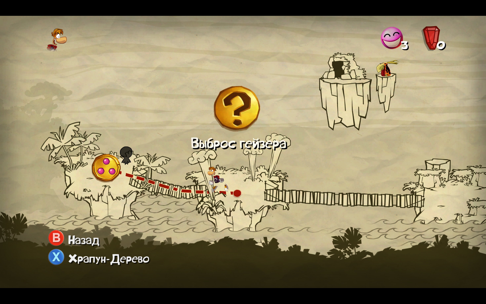

# RaymanOriginsRecomp-Switch

**An unofficial Nintendo Switch port of Rayman Origins (Xbox 360), built through static recompilation.**

The build translates the game's PowerPC code for the Switch's ARM64 CPU.
ReXGlue provides the runtime, and a Vulkan renderer using NVK draws the game
on the console. This project is independent of Ubisoft and Nintendo.


*Title screen*

[Build the port](#build-the-port) · [Install on Switch](#install-on-switch) · [Project status](#project-status) · [Screenshots](#screenshots) · [Credits and license](#credits-and-license)

> [!IMPORTANT]
> You'll need a legally obtained Xbox 360 copy of Rayman Origins. The game
> files, generated code and shaders, and finished NRO stay on your devices.

## Build the port

1. **Prepare your game dump.** The current Switch hooks target the retail
   revision whose `default.xex` SHA-256 starts with `53533ae1`. Compare the full
   hash in the [build guide](switch/README.md#prepare-the-upstream-code-and-your-game-dump)
   before building. If your dump is in Xbox 360 GOD format, use the included
   [extraction tool](tools/god_extract.py) to unpack it.
2. **Generate the game code and shaders.** Follow the
   [code generation steps](switch/README.md#generate-game-code-and-shaders-locally)
   for ReXGlue and SPIR-V. Keep the original directory structure of the dump.
3. **Build the NRO.** Set up ReXGlue and NVK, then follow the
   [Docker build commands](switch/README.md#build-the-switch-runtime-and-nro).
   The build produces `switch/game/build/rayman_switch.nro`.

The NRO build was verified on Apple Silicon macOS with Docker and devkitA64.
A full build from a fresh clone is still pending verification. The shader
preparation script currently selects macOS ARM64 DXC, so the end-to-end
workflow on other hosts is unverified.

## Install on Switch

You'll need a Switch running Atmosphère and set up to launch homebrew in
full-memory mode.

1. Create `switch/RaymanOriginsRecomp/` on the SD card.
2. Copy `rayman_switch.nro` into that folder and your extracted game files
   into its `game/` subfolder. Place `default.xex` directly inside `game/`.
3. Copy your generated `.spv` files into `native/spirv_ubo/` within the same
   port folder.
4. Open the Homebrew Menu in **full-memory application mode** and launch
   Rayman Origins.

The SD card should be laid out like this:

```text
sdmc:/switch/RaymanOriginsRecomp/
├── rayman_switch.nro
├── game/
│   ├── default.xex
│   └── … other files from your own game dump
└── native/
    └── spirv_ubo/
        └── … locally generated .spv shaders
```

Diagnostic builds write session logs to `logs/` in the port folder.

## Project status

| Verified on Switch hardware | Still being tested |
| --- | --- |
| Graphics, audio, input, saves, and two-player local co-op | Full playthrough and long-session stability |

This source preview includes a candidate fix for rare texture corruption
after extended play. The fix passed a local regression test. An extended
Switch run is still pending.

## Screenshots



*World map*

## Credits and license

- [XDanfr/RaymanOriginsRecomp](https://github.com/XDanfr/RaymanOriginsRecomp)
  and its contributors provided the recompilation base, native Vulkan renderer,
  and Switch reference work.
- **hihoffff** adapted the project for Switch starting in November 2026.
  The work includes ReXGlue and NVK integration, input, audio, saves, and
  renderer fixes.

The port's source code is licensed under the [GNU GPL v3](LICENSE). See the
[third-party notices](THIRD_PARTY_NOTICES.md) for upstream and dependency terms.

Game imagery © Ubisoft Entertainment.
