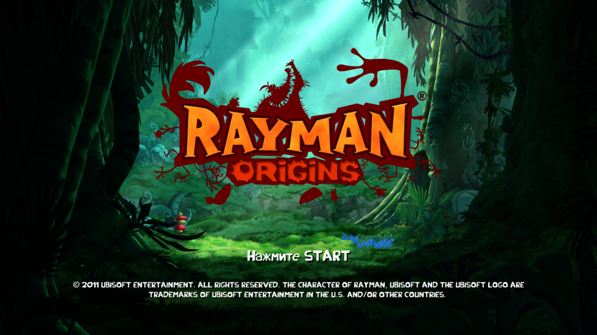

# RaymanOriginsRecomp-Switch

**An unofficial Nintendo Switch port of Rayman Origins (Xbox 360), built through static recompilation.**

The build translates the game's PowerPC code for the Switch's ARM64 CPU.
ReXGlue provides the runtime, and a Vulkan renderer using NVK draws the game
on the console. This project is independent of Ubisoft and Nintendo.



*Title screen*

[Build the port](#build-the-port) · [Install on Switch](#install-on-switch) · [Project status](#project-status) · [Screenshots](#screenshots) · [Credits and license](#credits-and-license)

> [!IMPORTANT]
> You'll need a legally obtained Xbox 360 copy of Rayman Origins. The game
> files, generated code and shaders, and finished NRO stay on your devices.

## Build the port

1. **Set up Docker and the dependencies.** Follow the
   [Switch build guide](switch/README.md#build-with-docker) for the one-time
   setup. On Windows, open an integrated WSL2 terminal.
2. **Prepare your game dump.** Put your own extracted Xbox 360 game files
   in `private/game/`. Compare the SHA-256 of `default.xex` with the hash
   in the build guide. For a GOD dump, use the
   [extraction tool](tools/god_extract.py).
3. **Build the NRO and SD files.** Run:

   ```sh
   bash switch/build.sh
   ```

   Docker generates the code and shaders and builds the NRO. The script
   prints the path to your local SD card files under `private/build-docker/`.

The full workflow was verified with x86-64 containers on Apple Silicon.
A fresh dependency setup, native Linux and Windows/WSL2 runs, and a Switch
run of the resulting NRO remain to be verified.

## Install on Switch

1. Back up any existing saves.
2. Copy the `switch/` folder from the build's `sd/` folder to the root of
   your SD card.
3. On a Switch running Atmosphère, open the Homebrew Menu in **full-memory
   application mode** and launch Rayman Origins.

The SD card should be laid out like this:

```text
sdmc:/switch/RaymanOriginsRecomp/
├── rayman_switch.nro
├── game/
│   ├── default.xex
│   └── … other files from your own game dump
└── native/
    └── spirv_ubo/
        └── … locally generated .spv shaders
```

Diagnostic builds write session logs to `logs/` in the port folder.

## Project status

| Verified on Switch hardware | Still being tested |
| --- | --- |
| Graphics, audio, input, saves, and two-player local co-op | Full playthrough and long-session stability |

This source preview includes a candidate fix for rare texture corruption
after extended play. The fix passed a local regression test. An extended
Switch run is still pending.

## Screenshots


*World map*

## Credits and license

- [XDanfr/RaymanOriginsRecomp](https://github.com/XDanfr/RaymanOriginsRecomp)
  and its contributors provided the recompilation base, native Vulkan renderer,
  and Switch reference work.
- **hihoffff** adapted the project for Switch starting in November 2026.
  The work includes ReXGlue and NVK integration, input, audio, saves, and
  renderer fixes.

The port's source code is licensed under the [GNU GPL v3](LICENSE). See the
[third-party notices](THIRD_PARTY_NOTICES.md) for upstream and dependency terms.

Game imagery © Ubisoft Entertainment.
